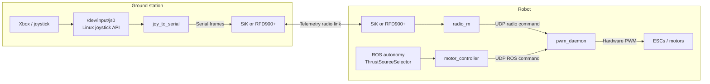

# Emergency teleop (non-ROS motor path)

## Goal

Keep a joystick override that still works if the robot ROS 2 stack dies.
ROS autonomy can run normally; radio teleop **overrides** it when armed.

## Roles

| Service | Where | Compose file | Role |
|---------|-------|--------------|------|
| `telemetry_tx` | Ground PC | `docker-compose.ground.telemetry.yaml` | Linux `js*` reader + `joy_to_serial` → telemetry radio |
| `ground_station` | Ground PC (`.103`) | `docker-compose.ground.yml` | RViz2 viewer for robot ROS topics (DDS) |
| `pwm_daemon` | Robot | `docker-compose.frontseat.yml` | **Only** process that writes motor PWM; mux + failsafe |
| `radio_rx` | Robot | `docker-compose.frontseat.yml` | Serial from radio → UDP to daemon (no ROS) |
| `frontseat` | Robot | `docker-compose.frontseat.yml` | ROS stack; `motor_controller` sends thrust to daemon over UDP |

### Ground station roles

**`telemetry_tx`** does **not** use ROS. It reads the controller via `/dev/input/js0` and sends framed packets over a **transparent UART telemetry radio** (Holybro SiK v3 **or** RFDesign RFD900+). The container uses Docker’s default bridge network, so it is isolated from robot DDS. The only teleop link to the boat is that serial radio.

**`ground_station`** (separate compose file) is for **RViz2** on the ground PC (`192.168.0.103`). It joins the same Cyclone DDS domain as Pi and Jetson to visualize LiDAR, camera, GPS, etc. It does not send motor commands.

(We intentionally avoid ROS 2 `joy_node` on the GS teleop container: it uses SDL and often fails to publish for Xbox 360 wireless receivers that still work fine as `/dev/input/js0`.)

## Data flow



### Mux priority (inside `pwm_daemon`)

1. **Radio** if `arm=true` and packet age ≤ profile `radio_timeout_s` (default 0.25 s)
2. Else **ROS** if `arm=true` and packet age ≤ profile `ros_timeout_s` (default 0.5 s)
3. Else **stop** (thrust 0)

## Device profiles (PWM backend + pins)

Defaults live in JSON, not scattered env vars:

| File | Platform | Backend | Pins |
|------|----------|---------|------|
| `devices/rpi.json` | Raspberry Pi | `pigpio` (hardware PWM) | BCM 19 / 12 (phys 35 / 32) |
| `devices/jetson.json` | Jetson Orin | `jetson` | BOARD 33 / 32 |

`pigpio` uses **hardware PWM** via `pigpiod` (built into the teleop image and started by `entrypoint.teleop.sh`). On Pi 4 use BCM **12 + 19** (physical pins 32 + 35). Avoid GPIO **13** — on some Pi 4 boards pigpio `hardware_PWM` never toggles that pin.

Select with `DEVICE_CONFIG`:

```bash
DEVICE_CONFIG=rpi docker compose -f docker-compose.frontseat.yml up -d pwm_daemon
DEVICE_CONFIG=jetson docker compose -f docker-compose.frontseat.yml up -d pwm_daemon
```

Safe bring-up without moving motors (override backend only):

```bash
DEVICE_CONFIG=rpi PWM_BACKEND_OVERRIDE=dry_run \
  docker compose -f docker-compose.frontseat.yml up -d pwm_daemon
```

## Telemetry radios (SiK and RFD900+)

Software treats the modem as a **transparent UART**. Swap hardware by pointing `RADIO_SERIAL_PORT` at the right USB device (**required** — no default); keep `RADIO_BAUD` matched to the modem’s UART speed (default **57600**).

| Modem | Typical USB-UART | `by-id` name contains |
|-------|------------------|------------------------|
| Holybro **SiK** Telemetry Radio v3 | FTDI **FT231X** | `FTDI_FT231X` |
| RFDesign **RFD900+** (USB adapter) | Silicon Labs **CP2102** | `Silicon_Labs_CP2102` |

Use a **matched pair** of the same modem type on GS and robot. Do not mix SiK with RFD900+ on one link.

### Finding the serial port

**1. List stable IDs (preferred):**

```bash
ls -l /dev/serial/by-id/
```

Examples:

```text
# SiK (Holybro)
usb-FTDI_FT231X_USB_UART_D30GKEF6-if00-port0 -> ../../ttyUSB0

# RFD900+ (this lab pair — both ends may share serial "0001"; that is OK across hosts)
usb-Silicon_Labs_CP2102_USB_to_UART_Bridge_Controller_0001-if00-port0 -> ../../ttyUSB0

# GPS — not the telemetry radio
usb-u-blox_AG_-_..._u-blox_GNSS_receiver-if00 -> ../../ttyACM0
```

```bash
# SiK example
export RADIO_SERIAL_PORT=/dev/serial/by-id/usb-FTDI_FT231X_USB_UART_D30GKEF6-if00-port0

# RFD900+ example
export RADIO_SERIAL_PORT=/dev/serial/by-id/usb-Silicon_Labs_CP2102_USB_to_UART_Bridge_Controller_0001-if00-port0

export RADIO_BAUD=57600
```

**2. Confirm vendor/product:**

```bash
udevadm info -q property -n /dev/ttyUSB0 | grep -E 'ID_VENDOR|ID_MODEL|ID_SERIAL'
```

- SiK v3: `ID_VENDOR=FTDI`, `ID_MODEL=FT231X_USB_UART`
- RFD900+: `ID_VENDOR=Silicon_Labs`, `ID_MODEL=CP2102_USB_to_UART_Bridge_Controller`

**3. Baud:** both families commonly use **57600** host UART (`RADIO_BAUD`). Some RFD units ship at **115200** (`ATS1=115`) — if open/link fails, check with AT commands below and set `RADIO_BAUD` to match, or set `ATS1=57` on the radio so it matches the compose default.

GPS modules (`u-blox` → `ttyACM*`) are **not** the telemetry radio.

### RFD900+ pairing / long-range settings

Use `configure_rfd_modem.py` on **each** modem (stop `telemetry_tx` / `radio_rx` first so the port is free). Both ends of a pair must get the same air/netid/freq settings.

**Defaults (lab teleop):** UART **57600**, air **64** kbps, NETID **25**, TX **20** dBm, MAVLINK **off**, OPPRESEND **off**. Both ends must match (including `S7`); older SiK **1.9** boards often ship with `OPPRESEND=1` while **1.13** uses `0` — that mismatch breaks pairing.

```bash
cd <repo>/src/teleop
PORT=/dev/serial/by-id/usb-Silicon_Labs_CP2102_USB_to_UART_Bridge_Controller_0001-if00-port0

python3 configure_rfd_modem.py --port "$PORT" --show   # inspect
python3 configure_rfd_modem.py --port "$PORT"          # apply defaults

# Longer range example (run identical args on the other modem too)
python3 configure_rfd_modem.py --port "$PORT" --air-speed 12 --tx-power 30
```

Without the script, enter AT mode (`+++`), match both radios, then:

```text
ATS1=57          # UART 57600 (must match RADIO_BAUD)
ATS2=64          # air rate; lower (e.g. 12) for more range; must match
ATS3=25          # NETID — must match
ATS4=20          # TX power dBm (up to 30 if legal); lab OK at 20
ATS6=0           # MAVLINK framing OFF (required for our 9-byte frames)
AT&W
ATZ
```

Verified lab pair (GS Alienware + Pi `.101`): `SERIAL_SPEED=57`, `AIR_SPEED=64`, `NETID=25`, `MAVLINK=0`, `TXPOWER=20`, host baud **57600**. Transparent serial + teleop frames round-tripped successfully.

Optional one-shot link check (GS → Pi → ACK) after both ports are open at 57600: write `GS->PI:HELLO\n` on one side and expect `PI->GS:ACK\n` on the other.

**Power:** RFD at higher TX power can draw ~1 A peaks. USB power can work for bench tests; for field/long range prefer a solid local 5 V on the boat (and on GS if USB browns out). Antennas must be attached before transmitting.

### Swapping SiK ↔ RFD900+

1. Plug the chosen pair on GS and robot.  
2. Export the matching `RADIO_SERIAL_PORT` on each host (and `RADIO_BAUD` if not 57600).  
3. Restart `telemetry_tx` / `radio_rx` — no code changes.

## Serial protocol

9-byte little-endian frame (see `protocol.py`):

`AA 55 | left_i16 | right_i16 | flags | seq | crc8`

- Thrust: `i16 = round(thrust * 1000)`, range `[-1, 1]`
- `flags` bit0 = **arm** (deadman held — default **button[5]**)

## IPC to the daemon

UDP JSON to `127.0.0.1:5600` (host network on the robot):

```json
{"source":"ros"|"radio","left":0.2,"right":-0.1,"arm":true,"seq":1}
```

## Controller setup — what to run (both machines)

Plug in the telemetry radio pair (SiK **or** RFD900+) on **both** sides and the Xbox receiver on the ground PC first.

### 0) Identify devices (each machine)

```bash
# Joystick (ground PC only)
ls -l /dev/input/js*

# Telemetry radio (both machines) — prefer by-id, see section above
ls -l /dev/serial/by-id/
```

Optional: map axes/buttons on the ground PC before starting compose:

```bash
# stop telemetry container if it already holds js0
docker stop mini_bream_telemetry_tx 2>/dev/null
cd <repo>/src
python3 teleop/js_dump.py          # move sticks / press buttons; note indices
```

Current Xbox defaults (after mapping):

| Control | Index | Flag |
|---------|-------|------|
| Left thrust | `axis[1]` | `--left-axis 1` |
| Right thrust | `axis[4]` | `--right-axis 4` |
| Deadman (arm) | `button[5]` | `--deadman-button 5` |

### 1) Robot (Raspberry Pi) — start first

```bash
cd <repo>/src/docker

# Safe bring-up (logs thrust, does not drive ESCs)
# SiK:   RADIO_SERIAL_PORT=/dev/serial/by-id/usb-FTDI_FT231X_USB_UART_<ROBOT_SERIAL>-if00-port0
# RFD900+: RADIO_SERIAL_PORT=/dev/serial/by-id/usb-Silicon_Labs_CP2102_USB_to_UART_Bridge_Controller_0001-if00-port0
DEVICE_CONFIG=rpi PWM_BACKEND_OVERRIDE=dry_run \
RADIO_SERIAL_PORT=/dev/serial/by-id/usb-Silicon_Labs_CP2102_USB_to_UART_Bridge_Controller_0001-if00-port0 \
RADIO_BAUD=57600 \
  docker compose -f docker-compose.frontseat.yml up -d --build pwm_daemon radio_rx

# When ready for real motors, omit PWM_BACKEND_OVERRIDE (uses devices/rpi.json → pigpio hw PWM)
# DEVICE_CONFIG=rpi RADIO_SERIAL_PORT=... docker compose -f docker-compose.frontseat.yml up -d pwm_daemon radio_rx

# Optional: ROS autonomy / frontseat (separate; not required for radio override)
docker compose -f docker-compose.frontseat.yml up --build frontseat
```

Watch robot logs:

```bash
docker logs -f mini_bream_pwm_daemon
docker logs -f mini_bream_radio_rx
```

You want `radio_rx` to open the radio port, and when the GS is armed, `pwm_daemon` should show `Active source → radio`.

### 2) Ground PC — emergency teleop transmitter

```bash
cd <repo>/src/docker

# Match the modem type on the Pi (SiK FTDI by-id or RFD CP2102 by-id)
RADIO_SERIAL_PORT=/dev/serial/by-id/usb-Silicon_Labs_CP2102_USB_to_UART_Bridge_Controller_0001-if00-port0 \
RADIO_BAUD=57600 \
JOY_DEVICE=/dev/input/js0 \
  docker compose -f docker-compose.ground.telemetry.yaml up --build
```

Watch telemetry logs:

```bash
docker logs -f mini_bream_telemetry_tx
```

Expect something like:

```text
Joystick /dev/input/js0 (8 axes, 15 buttons) → serial ... [left=axis[1] right=axis[4] deadman=button[5]]
```

Hold **button[5]** → log `Deadman ARMED`; release → `disarmed` / robot falls back to ROS or stop.

### Order summary

1. Power radios (antennas on) + Xbox receiver  
2. On **Pi**: `pwm_daemon` + `radio_rx` (`docker-compose.frontseat.yml`)  
3. On **ground PC**: `telemetry_tx` (`docker-compose.ground.telemetry.yaml`)  
4. Hold deadman (**button[5]**), move **axis[1]** / **axis[4]**, confirm Pi daemon logs  

### RViz2 on ground PC (optional)

On the ground-station computer (`192.168.0.103`), with Pi/Jetson stacks running:

```bash
cd <repo>/src/docker
xhost +local:docker
docker compose -f docker-compose.ground.yml up --build
```

## Failsafe notes

- Ground station always sends frames; with deadman released, `arm=0` and thrust 0.
- If radio goes silent longer than the timeout, radio priority drops immediately.
- If ROS also dies, daemon holds stop.
- `pwm_daemon` should stay up (`restart: unless-stopped`); it is the safety-critical service.
